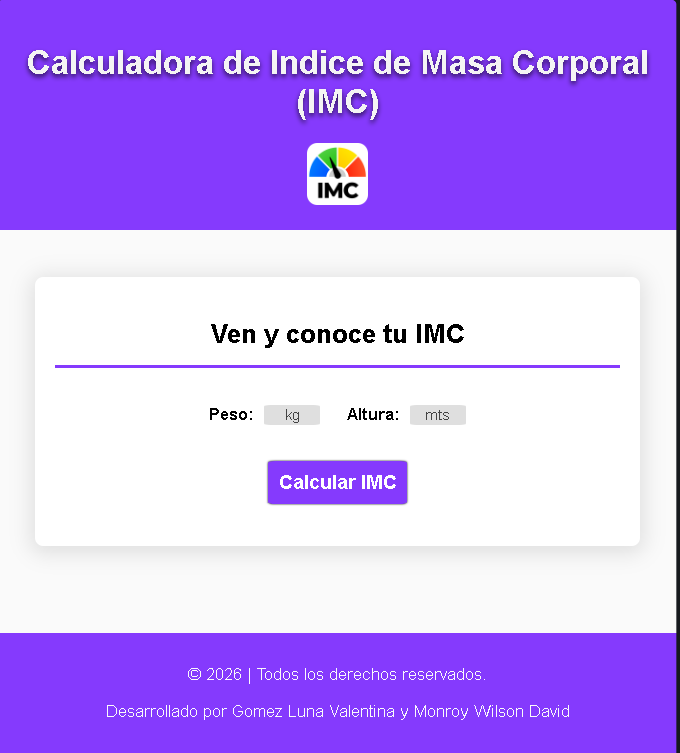
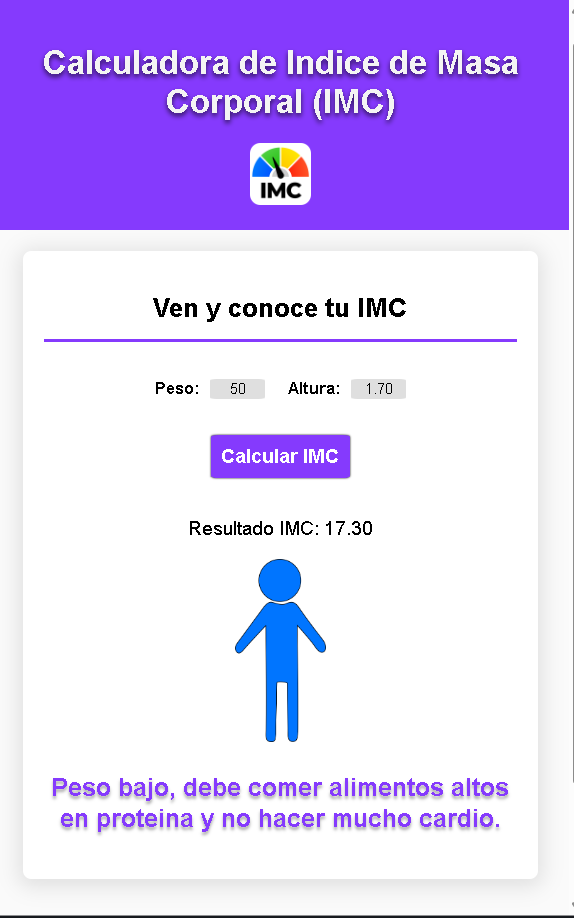
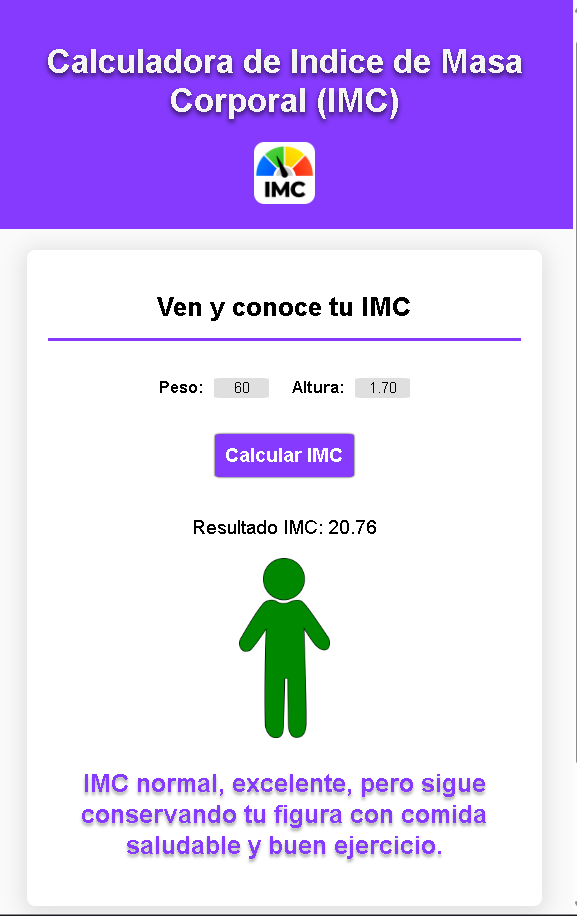
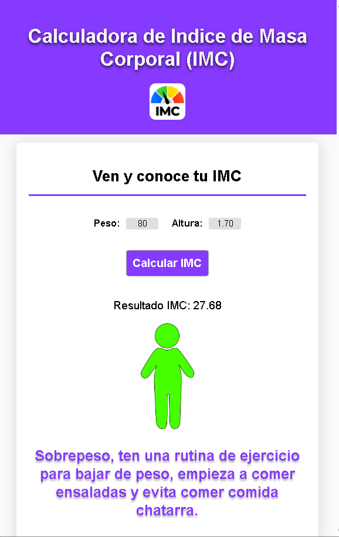
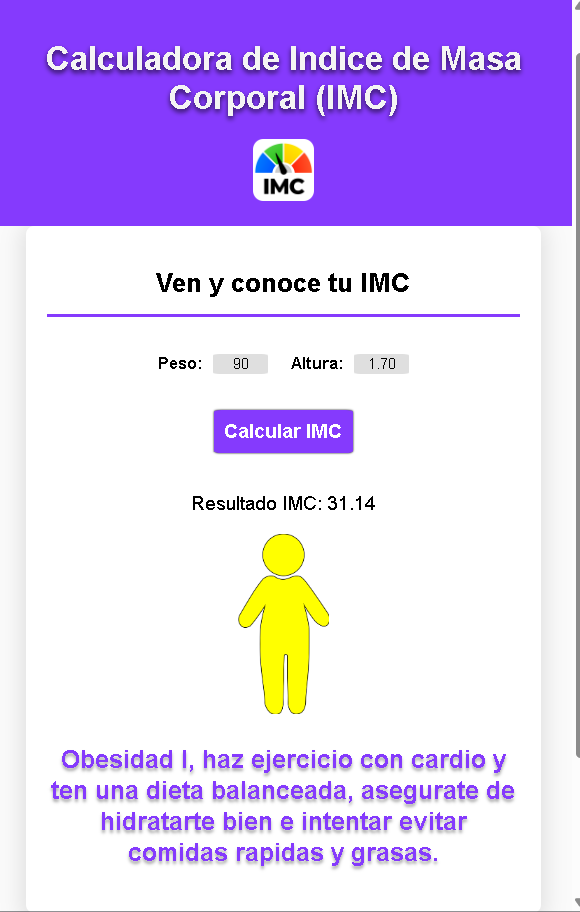
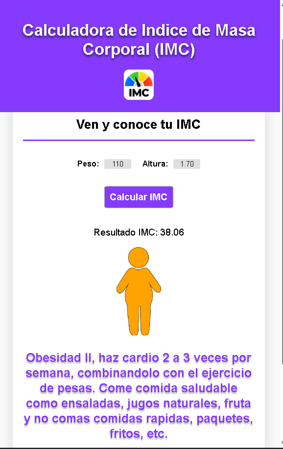
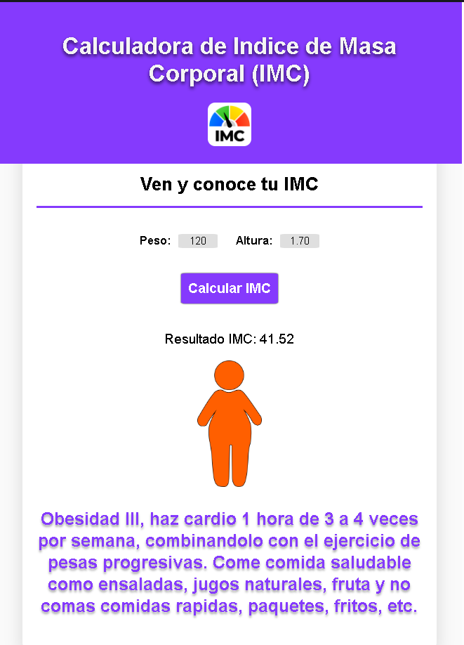
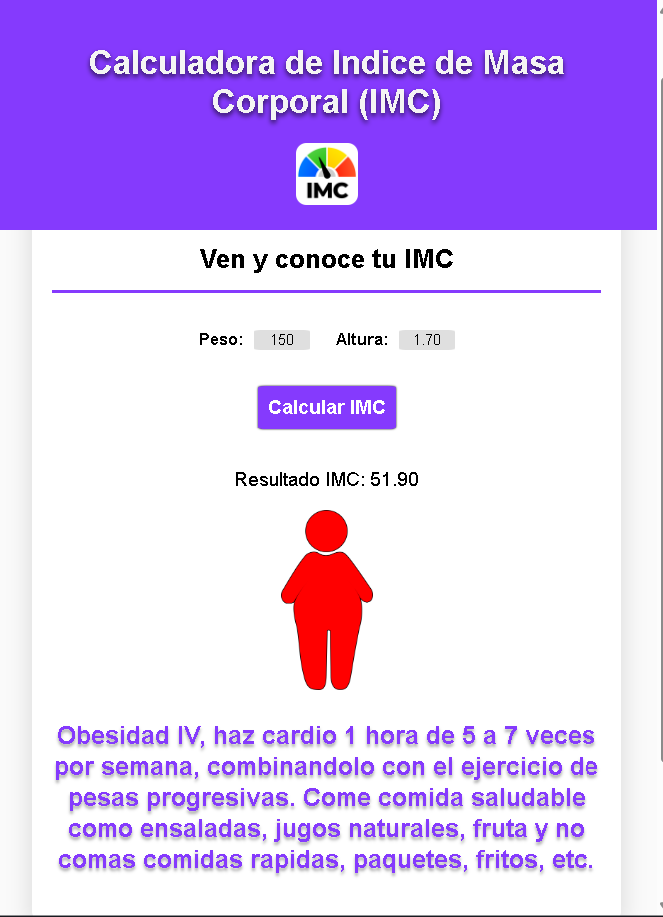

# Calculadora de Índice de Masa Corporal (IMC) – Centro Médico

## 1. Enunciado del problema

En un centro médico se necesita un desarrollador que cree un **software web** que calcule el **índice de masa corporal (IMC)** de sus pacientes y **recomiende una rutina de ejercicios junto con una alimentación balanceada** según cada paciente.

---

## 2. Análisis del problema

### 2.1 Entradas
| Dato | Unidad | Campo HTML | Ejemplo |
|------|--------|-----------|---------|
| Peso | kg | `#inputPeso` | 50 |
| Altura | metros | `#inputAltura` | 1.70 |

### 2.2 Proceso
1. El paciente digita su peso y su altura.
2. Al hacer clic en **"Calcular IMC"** se valida que ninguno de los dos valores sea 0 o esté vacío.
3. Se aplica la fórmula:

```
IMC = peso (kg) / altura² (m²)
```

4. Según el valor del IMC se elige una **categoría**, una **imagen** y un **mensaje** de recomendación de ejercicio y alimentación.

### 2.3 Salidas
- `Resultado IMC: 17.30` (con 2 decimales, usando `toFixed(2)`).
- Imagen de una figura humana acorde a la categoría.
- Mensaje con la recomendación (en morado, negrita).
- Si falta el peso o la altura: *"No se puede obtener el IMC sin un peso/altura."* (en rojo).

---

## 3. Solución implementada

Página web de una sola vista, hecha con **HTML + CSS + JavaScript** puros (sin librerías).

### 3.1 Estructura de archivos

```
CalculadoraIMC/
├── index.html          → estructura de la página y lógica en JavaScript
├── styles.css          → estilos
└── Assets/
    └── Images/
        ├── imc/        → figuras: BajoPeso, Normal, SobrePeso,
        │                 Obesidad1, Obesidad2, Obesidad3, Obesidad4 (.webp)
        └── screens/    → capturas de pantalla (pantalla1 a pantalla8)
```

### 3.2 Estructura de la página (HTML)

| Zona | Elemento | Contenido |
|---|---|---|
| Encabezado | `<header>` | Título *"Calculadora de Indice de Masa Corporal (IMC)"* + icono IMC |
| Tarjeta | `<main><section>` | Subtítulo *"Ven y conoce tu IMC"* |
| Formulario | `#container_calcImc` | Inputs numéricos de **Peso** (`kg`) y **Altura** (`mts`) |
| Botón | `#btn_calcularImc` | **Calcular IMC** |
| Resultado | `#resultado_imc` | Contenedor vacío que se llena por JavaScript |
| Pie | `<footer>` | © 2026 \| Todos los derechos reservados. |

### 3.3 Lógica en JavaScript

1. **Captura de elementos del DOM** una sola vez (`inputPeso`, `inputAltura`, `btnCalcImc`, `campoResultado`).
2. **Bloqueo de teclas inválidas:** en ambos inputs, con el evento `keydown`, se impide digitar `e`, `E`, `-` y `+`.
3. **Evento `click` del botón:** hace `event.preventDefault()` y llama a `calcularImc()`.
4. **Función `calcularImc()`:**
   - Convierte los valores con `parseFloat(...) || 0` (si no es número queda en 0).
   - Si `peso != 0 && altura != 0` calcula `imc = peso / (altura * altura)`; si no, muestra el error.
   - Asigna `textoMostrar` y `tipoImagen` según el rango del IMC.
   - Pinta el resultado con `innerHTML`: texto del IMC, imagen `Assets/Images/imc/<tipoImagen>.webp` y mensaje.

### 3.4 Clasificación del IMC (tal como está en el código)

| Rango de IMC | Categoría | Imagen | Mensaje mostrado |
|---|---|---|---|
| `< 18.5` | Peso bajo | `BajoPeso.webp` | Peso bajo, debe comer alimentos altos en proteína y no hacer mucho cardio. |
| `>= 18.5` y `< 25` | Normal | `Normal.webp` | IMC normal, excelente, pero sigue conservando tu figura con comida saludable y buen ejercicio. |
| `>= 25` y `< 30` | Sobrepeso | `SobrePeso.webp` | Sobrepeso, ten una rutina de ejercicio para bajar de peso, empieza a comer ensaladas y evita comer comida chatarra. |
| `>= 30` y `< 35` | Obesidad I | `Obesidad1.webp` | Obesidad I, haz ejercicio con cardio y ten una dieta balanceada, asegúrate de hidratarte bien e intentar evitar comidas rápidas y grasas. |
| `>= 35` y `< 40` | Obesidad II | `Obesidad2.webp` | Obesidad II, haz cardio 2 a 3 veces por semana, combinándolo con el ejercicio de pesas. Come comida saludable como ensaladas, jugos naturales, fruta y no comas comidas rápidas, paquetes, fritos, etc. |
| `>= 40` y `< 50` | Obesidad III | `Obesidad3.webp` | Obesidad III, haz cardio 1 hora de 3 a 4 veces por semana, combinándolo con el ejercicio de pesas progresivas. Come comida saludable como ensaladas, jugos naturales, fruta y no comas comidas rápidas, paquetes, fritos, etc. |
| `>= 50` | Obesidad IV | `Obesidad4.webp` | Obesidad IV, haz cardio 1 hora de 5 a 7 veces por semana, combinándolo con el ejercicio de pesas progresivas. Come comida saludable como ensaladas, jugos naturales, fruta y no comas comidas rápidas, paquetes, fritos, etc. |

### 3.5 Estilos (CSS)

- **Color principal:** morado `#853afd` (encabezado, pie, línea del subtítulo, botón y mensaje de recomendación).
- **Fondo:** `#f4f4ff` (body) y `#fafafa` (main); la tarjeta es blanca con bordes redondeados y sombra.
- **Tipografía:** Helvetica / Arial; el título del encabezado lleva `text-shadow`.
- **Inputs:** 50 px de ancho, fondo gris `#dfdfdf`, texto centrado; al enfocarse muestran borde morado y sombra; se ocultan las flechas del input numérico.
- **Botón:** morado, texto blanco, con efecto `hover` (sombra y cursor de mano).
- **Resultado:** texto del IMC en negro (18 px), mensaje en morado y negrita (24 px), error en rojo y negrita, imagen de `10vh` de ancho.

---

## 4. Pruebas realizadas (altura 1.70 m)

| Pantalla | Peso (kg) | IMC | Categoría |
|---|---|---|---|
| 1 | – | – | Formulario vacío (estado inicial) |
| 2 | 50 | **17.30** | Peso bajo |
| 3 | 60 | **20.76** | Normal |
| 4 | 80 | **27.68** | Sobrepeso |
| 5 | 90 | **31.14** | Obesidad I |
| 6 | 110 | **38.06** | Obesidad II |
| 7 | 120 | **41.52** | Obesidad III |
| 8 | 150 | **51.90** | Obesidad IV |

En las pantallas la figura cambia de **color** (azul → verde → amarillo → naranja → rojo) y de **forma** (de delgada a más ancha) según la categoría.

### Pantalla 1 – Estado inicial


### Pantalla 2 – Peso bajo (50 kg → IMC 17.30)


### Pantalla 3 – Normal (60 kg → IMC 20.76)


### Pantalla 4 – Sobrepeso (80 kg → IMC 27.68)


### Pantalla 5 – Obesidad I (90 kg → IMC 31.14)


### Pantalla 6 – Obesidad II (110 kg → IMC 38.06)


### Pantalla 7 – Obesidad III (120 kg → IMC 41.52)


### Pantalla 8 – Obesidad IV (150 kg → IMC 51.90)


---

## 5. Algoritmo (pseudocódigo)

```
INICIO
  LEER peso, altura          (si no es número → 0)
  SI peso = 0 O altura = 0 ENTONCES
      MOSTRAR "No se puede obtener el IMC sin un peso/altura."
      FIN
  imc ← peso / (altura * altura)

  SI imc < 18.5 ENTONCES       categoría ← "Peso bajo"
  SI 18.5 <= imc < 25          categoría ← "Normal"
  SI 25   <= imc < 30          categoría ← "Sobrepeso"
  SI 30   <= imc < 35          categoría ← "Obesidad I"
  SI 35   <= imc < 40          categoría ← "Obesidad II"
  SI 40   <= imc < 50          categoría ← "Obesidad III"
  SI imc >= 50                 categoría ← "Obesidad IV"

  MOSTRAR "Resultado IMC: " + imc con 2 decimales
  MOSTRAR imagen y mensaje de la categoría
FIN
```


<p style="text-align: center; font-weight: bold; font-style: italic">Desarrollado por Gomez Luna Valentina y Monroy Wilson David</p>